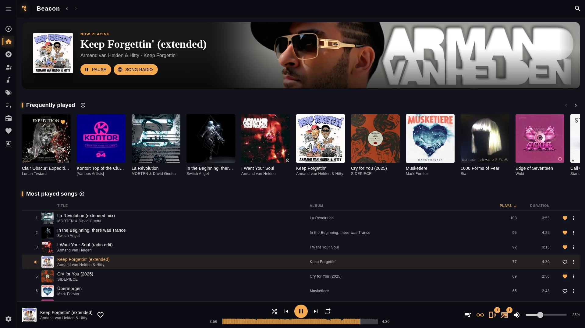
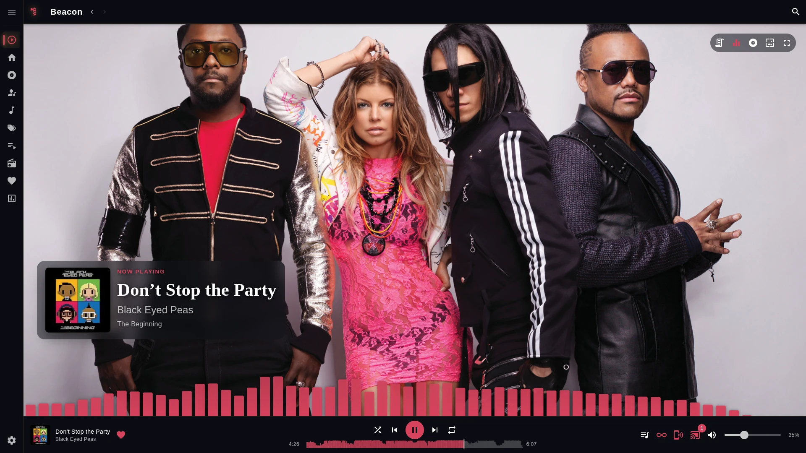
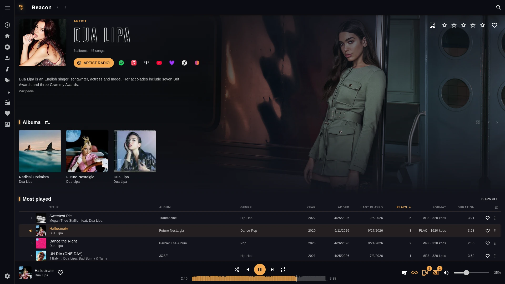
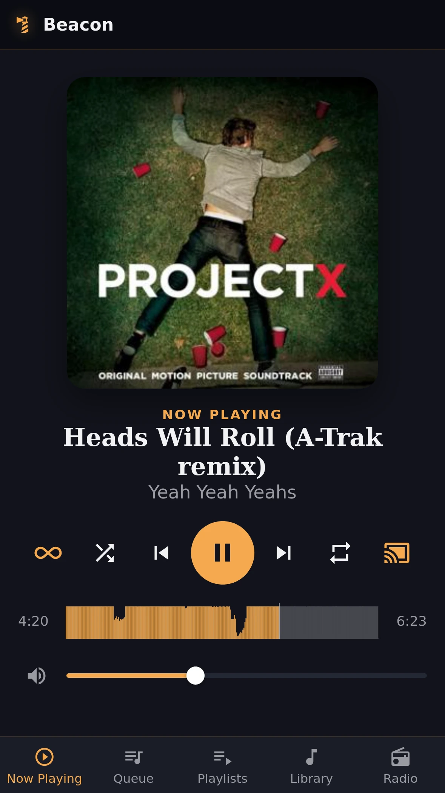
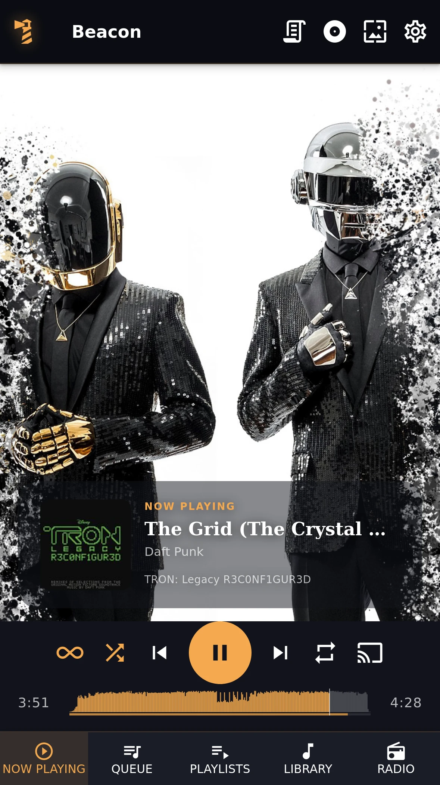

<p align="center">
  
</p>

# Beacon

> A self-hosted music client for Navidrome, Subsonic / OpenSubsonic, Jellyfin and Plex - with built-in casting to Sonos, AirPlay, Chromecast, and DLNA/UPnP devices.

<p align="center"><sub>Yes, that's just <code>mdi-lighthouse-on</code> tinted amber. I write backend code for a living, not logos. This is as good as the branding gets.</sub></p>

<p align="center">
  <a href="https://github.com/mihaitom/beacon/actions/workflows/test-python.yml"></a>
  <a href="https://codecov.io/gh/mihaitom/beacon?flags%5B0%5D=backend"></a>
  <a href="https://github.com/mihaitom/beacon/actions/workflows/test-frontend.yml"></a>
  <a href="https://codecov.io/gh/mihaitom/beacon?flags%5B0%5D=frontend"></a>
  <a href="https://github.com/mihaitom/beacon/commits/main"></a>
  <a href="https://github.com/mihaitom/beacon/blob/main/LICENSE"></a>
</p>

> **Development note:** This project is developed with AI assistance, and is covered by an extensive automated test suite. Issue reports are welcome.

---

## Screenshots

<p align="center">
  
  <br><em>Home</em>
</p>
<p align="center">
  
  <br><em>Now Playing</em>
</p>
<p align="center">
  
  <br><em>Artist</em>
</p>
<p align="center">
  
  
  <br><em>Remote Control (Electron) and the responsive mobile web UI (Docker/web)</em>
</p>

---

## Why Beacon?

Beacon grew out of [Feishin Connect](https://github.com/mihaitom/feishin-connect), my own fork of [jeffvli/feishin](https://github.com/jeffvli/feishin) - a general-purpose Electron/React music player - that added a Python casting backend (`connect/`) as a feature bolted onto it (a button in the player bar). That backend, a real self-contained FastAPI service discovering cast devices, streaming to them, and tracking playback state on its own, turned out to be the part worth building on. But building on top of it meant building _around_ Feishin: every change had to fit inside an app and a codebase designed for a different purpose, and that got harder, not easier, the more `connect` grew into its own thing.

Beacon is `connect` as the actual foundation instead of an add-on - a frontend built specifically for it, not retrofitted onto one. Every playback action (local _and_ cast) goes through the same session, the same clock, the same auth token, instead of two loosely-connected halves of an app. The frontend is a from-scratch Vue 3 rebuild rather than carrying along Feishin's inherited React codebase and its full general-purpose feature surface. What that's bought so far: multi-user sessions where independent logins on the same deployment get independent playback to independent devices at the same time, a lyrics/visualizer sync calibrated against each cast device's own real position rather than a fixed guess, a login/session model that treats Jellyfin and Plex as first-class server types instead of an afterthought, and a phone that can either pair up as a dedicated remote for the desktop app or simply _be_ the player itself on the web build.

---

## Features

**Casting is the point.** Beacon grew around a backend that talks to real speakers on its own, and the rest of the app is built on top of that. Everything you would expect is here too - a full library (albums, artists, tracks, genres, playlists, favorites, with local filtering and search), a home page built from your own listening, top tracks, artists, albums and formats on a Stats page, multiselect and bulk queue/playlist actions, starring and rating, synced or unsynced lyrics, light and dark themes or one of your own, and a UI in German, English, Spanish, French and Italian.

What makes Beacon worth running, from casting to several speakers at once to party mode and the Jellyfin and Plex details, is in [docs/help/features.md](docs/help/features.md). The app's help shows the same page under "What Beacon can do".

### Keyboard shortcuts

| Key                | Action                                 |
| ------------------ | -------------------------------------- |
| `Space` / `K`      | Play / pause                           |
| `←` / `→`          | Back / forward 5 seconds               |
| `Ctrl` + `←` / `→` | Previous / next track (`Cmd` on macOS) |
| `Alt` + `←` / `→`  | Back / forward through pages           |
| `Ctrl` + `K`       | Jump to the search (`Cmd` on macOS)    |
| `↑` / `↓`          | Volume up / down                       |
| `M`                | Mute                                   |
| `S`                | Toggle shuffle                         |
| `R`                | Cycle repeat mode                      |
| `F`                | Favorite the current track             |
| `Q`                | Show / hide the queue                  |
| `0` - `9`          | Jump to 0-90% of the track             |
| `?`                | Show this list in the app              |

They do nothing while you are typing in a field or a dialog is open, and leave a focused button or slider its own keys. The volume keys change the speaker's volume while casting to a single device, the same as the volume slider in the player bar does.

---

## Docker (recommended)

> **`network_mode: host` is required.** The Connect backend discovers Sonos, AirPlay, Chromecast, and DLNA devices via mDNS/SSDP multicast, which only works when the container shares the host's network stack. Without it, no devices will be found. Host networking is Linux-only - on Mac or Windows, run the backend natively instead.

> [!CAUTION]
> **Not designed to be exposed to the open internet on its own.** This deployment expects an authentication layer in front of it (e.g. Authentik, Authelia, or a reverse proxy with basic auth) if it's reachable from outside your local network. Your media server's own login is not a substitute for that.

```yaml
services:
  beacon:
    container_name: beacon
    image: ghcr.io/mihaitom/beacon:latest
    restart: unless-stopped
    network_mode: host
    volumes:
      - ./data:/data
```

That's it - Beacon asks for your server URL, username, and password on first launch; nothing needs to be pre-configured. See the environment variables below for optional locking, LAN optimization, and SSO scenarios.

**Mount a volume at `/data`** to keep AirPlay 2 pairings, your log-level setting, your account settings (language, personalized recommendations, lyrics providers, Autoplay batch size, transition settings), the recommendations cache, the Fanart.tv image cache, API keys entered in Settings, each station's played-titles list, the casting allow-list, and (for Jellyfin/Plex sessions) your internet radio stations across container recreations/updates.

### Environment variables

| Variable                 | Default                | Description                                                                                                                                                                                                                                                                                                                                                                                                                                                                                                                                                                                                                                                                                                                                                                                                                                                                                                                                                                                        |
| ------------------------ | ---------------------- | -------------------------------------------------------------------------------------------------------------------------------------------------------------------------------------------------------------------------------------------------------------------------------------------------------------------------------------------------------------------------------------------------------------------------------------------------------------------------------------------------------------------------------------------------------------------------------------------------------------------------------------------------------------------------------------------------------------------------------------------------------------------------------------------------------------------------------------------------------------------------------------------------------------------------------------------------------------------------------------------------- |
| `WEB_PORT`               | `7070`                 | Port nginx (the Beacon web UI) listens on. Change if `7070` is already taken on the host.                                                                                                                                                                                                                                                                                                                                                                                                                                                                                                                                                                                                                                                                                                                                                                                                                                                                                                          |
| `PORT`                   | `7071`                 | Port the Connect API (Python backend) listens on. Change if `7071` is already in use - nginx still proxies `/api/` to whatever `PORT` is set to, no other change needed.                                                                                                                                                                                                                                                                                                                                                                                                                                                                                                                                                                                                                                                                                                                                                                                                                           |
| `CONNECT_TOKEN`          | _(random per start)_   | Secret token protecting the Connect API. If unset, a random one is generated each start - nginx adds it to every internal request automatically, so the browser never handles it directly. Only set this explicitly if something needs to call the API directly, bypassing nginx, with a token that survives restarts.                                                                                                                                                                                                                                                                                                                                                                                                                                                                                                                                                                                                                                                                             |
| `CONNECT_DATA_DIR`       | `/data` in Docker      | Directory persistent backend files are stored in - AirPlay 2 pairing credentials, the log-level setting, per-account settings, the recommendations cache, the Fanart.tv image cache, the API keys entered in Settings, resolved radio station logos, each account's radio title log, the casting allow-list, and (Jellyfin/Plex sessions only) internet radio stations. Docker already defaults this to `/data`; just mount a volume there.                                                                                                                                                                                                                                                                                                                                                                                                                                                                                                                                                        |
| `NAVIDROME_INTERNAL_URL` | -                      | A second, more directly reachable address for Navidrome, used instead of the URL you log in with for everything Beacon fetches from the server itself: every API request, the **audio it streams** to the app and to cast devices, and the cover art cast devices (Sonos/Chromecast/AirPlay/DLNA) load directly. **Navidrome/Subsonic only** - see `JELLYFIN_INTERNAL_URL` below for the Jellyfin equivalent; Plex has none (its server address comes from Plex's own account-based discovery, not a URL you type in). Worth setting whenever you log in through a public URL behind a reverse proxy (Traefik, nginx, Cloudflare, an SSO layer) while Beacon could reach Navidrome directly, e.g. `http://192.168.1.10:4533`: the audio then no longer takes the detour through that proxy, and its timeouts or buffering can't interrupt a track. It also gives cast devices a LAN-reachable address for cover art when you log in from a different network than they are on. See the note below. |
| `JELLYFIN_INTERNAL_URL`  | -                      | Same idea as `NAVIDROME_INTERNAL_URL` above, for Jellyfin sessions. A separate variable rather than reusing `NAVIDROME_INTERNAL_URL` for both - a Jellyfin session checked against a Navidrome-shaped internal address always failed (Navidrome has no `/Users/Me` endpoint for Jellyfin's own login check to hit).                                                                                                                                                                                                                                                                                                                                                                                                                                                                                                                                                                                                                                                                                |
| `SERVER_URL`             | -                      | The server's public-facing identity. Used only for the `SERVER_LOCK` allow-list and to prefill the login screen - never proxied.                                                                                                                                                                                                                                                                                                                                                                                                                                                                                                                                                                                                                                                                                                                                                                                                                                                                   |
| `SERVER_LOCK`            | `false`                | When `true`, the login screen shows only username/password - server URL and type are fixed to `SERVER_URL` (or `NAVIDROME_INTERNAL_URL` as a fallback) and `SERVER_TYPE`.                                                                                                                                                                                                                                                                                                                                                                                                                                                                                                                                                                                                                                                                                                                                                                                                                          |
| `SERVER_TYPE`            | `subsonic`             | What kind of server `SERVER_URL`/`SERVER_LOCK` point at - `subsonic` (covers Navidrome), `jellyfin`, or `plex`. Only meaningful together with `SERVER_LOCK=true`.                                                                                                                                                                                                                                                                                                                                                                                                                                                                                                                                                                                                                                                                                                                                                                                                                                  |
| `ALLOWED_ORIGINS`        | -                      | Extra CORS origins for the Connect API, comma-separated. Not needed in standard Docker deployments - browser and API share the same domain via nginx, so requests are same-origin and CORS never applies. Only relevant if the backend is reached from a different origin than the page.                                                                                                                                                                                                                                                                                                                                                                                                                                                                                                                                                                                                                                                                                                           |
| `LOG_LEVEL`              | -                      | Startup log verbosity - `trace`, `debug`, `info`, `warning`, or `error` (case-insensitive). Prefer the log-level dropdown in Settings instead (same five levels, persisted, in effect immediately, no restart needed) - this is only the fallback for a deployment that never comes up far enough to reach it. `debug` covers Beacon's own code only; `trace` also turns on the third-party libraries underneath it (SoCo, pyatv, `httpx`/`httpcore`, `uvicorn.access`) for SOAP/HTTP-level detail - a lot of output, so reach for it only when actually troubleshooting one of those.                                                                                                                                                                                                                                                                                                                                                                                                             |
| `COVER_CACHE_MB`         | `128`                  | How much memory (in MB) Beacon may use to keep cover art and artist photos it has already fetched, so a second device, a browser reload or a view you come back to is answered without going to the music server again. Enough for roughly 5,000 albums at the default. Lower it on a small NAS, raise it for a very large library; the cache gives up whatever was looked at longest ago first, so a smaller value costs speed on old covers, never correctness. A value that isn't a number (or a variable left empty) falls back to the default instead of stopping the server, and anything below `1` is treated as `1`. See [Artwork caching](#artwork-caching) below for a recommendation by library size.                                                                                                                                                                                                                                                                                   |
| `TRUSTED_PROXIES`        | `127.0.0.1/32,::1/128` | Reverse proxies whose `X-Forwarded-For`/`X-Forwarded-Proto` Beacon believes, as comma-separated addresses or networks. The default is the nginx inside the container. Behind Traefik or another proxy in front of the container, add the address it reaches Beacon from, or every client counts as that proxy. Today only party mode acts on it, to rate-limit each guest by their own address. See [docs/party-mode.md](docs/help/party-mode.md#client-addresses).                                                                                                                                                                                                                                                                                                                                                                                                                                                                                                                                |
| `LASTFM_API_KEY`         | -                      | A Last.fm application key, which turns on the Last.fm playlist builder: it fills a new playlist from Last.fm (country or global charts, a genre's top tracks, one artist's top tracks, tracks similar to a song of your own, or your own listening history) using the tracks your library actually has. Usually there is no need to set this - the key can be entered in Settings under Advanced, API keys, instead, which is the only way on a desktop install, and it is stored in `CONNECT_DATA_DIR`. This variable is the equivalent for a Docker deployment that would rather configure it up front; a key entered in Settings takes precedence over it. Request a key at `last.fm/api/account/create`. The key belongs to the Beacon installation rather than to each listener: one covers everyone using it, who then only enter their own Last.fm username for the history-based playlist. With no key from either source, the builder is not offered.                                     |
| `FANART_API_KEY`         | -                      | A personal Fanart.tv API key. Optional: Beacon ships its own project key, so the artist images work without it. A personal key is sent alongside it and is what Fanart.tv's terms ask each installation for; it can also be entered in Settings under Advanced, API keys, which takes precedence over this variable.                                                                                                                                                                                                                                                                                                                                                                                                                                                                                                                                                                                                                                                                               |

> `NAVIDROME_INTERNAL_URL` doesn't need a Docker Compose service name (e.g. `http://navidrome:4533`) - with `network_mode: host` there's no Docker bridge network for that to resolve on. If Navidrome runs on the same host, point this at its directly-reachable address instead, e.g. `http://localhost:4533`.

### Requirements

- Navidrome, a Subsonic/OpenSubsonic-compatible server, or Jellyfin/Plex (see above for what differs)
- Sonos, AirPlay, Chromecast, and/or DLNA/UPnP devices on the same network as the Docker host, if you want to cast (other subnets and VLANs work too, see [docs/help/networking.md](docs/help/networking.md))
- Docker host on Linux (host networking is Linux-only)

---

## Electron (desktop app)

**Installing on macOS:** the app is not signed with an Apple Developer ID, so the first launch is blocked with "Apple could not verify Beacon is free of malware". Click Done, then open System Settings > Privacy & Security and choose "Open Anyway" next to the Beacon message. If macOS reports the app as damaged instead (versions up to 1.6.0), remove the download quarantine in the terminal: `xattr -dr com.apple.quarantine /Applications/Beacon.app`.

The Connect backend starts and stops automatically alongside the Electron app - no separate Python installation needed in the packaged build. Its port is selected dynamically at startup (from 7071), so it never conflicts with anything else already using that port.

**Development** (Node with pnpm, and Python with [uv](https://docs.astral.sh/uv/) for the backend):

```bash
pnpm install
pnpm run dev   # starts both the Connect backend (uv run python main.py) and Electron
```

**Packaging** (builds the Connect backend into a standalone binary via PyInstaller first, then the Electron app):

```bash
pnpm run package        # current platform
pnpm run package:linux  # or publish:linux / publish:mac / publish:win, etc. - see package.json
```

**ffmpeg** is built and bundled with the app - nothing to install. The build runs as part of every `package`/`publish` script and is skipped when it is already up to date; see [build/ffmpeg/README.md](build/ffmpeg/README.md) for what it needs per platform. Setting `FFMPEG_PATH` points Beacon at your own build instead.

**Persistent backend data** (AirPlay 2 pairing credentials, log-level setting, per-account settings, recommendations cache, Fanart.tv image cache, API keys, radio played-titles lists, Jellyfin/Plex internet radio stations) lives in Electron's standard per-user data directory, which survives app updates:

| Platform | Path                                   |
| -------- | -------------------------------------- |
| Windows  | `%APPDATA%\Beacon`                     |
| macOS    | `~/Library/Application Support/Beacon` |
| Linux    | `~/.config/Beacon`                     |

### Web build (no Electron)

```bash
pnpm run build:web   # or vite's own dev server for local development
```

The bare web build talks to a separately-running Connect backend (`cd connect && uv run python main.py`) - see `docker-compose.yaml`'s comments and `connect/.env.example` for the environment variables it reads.

---

## Artwork caching

Cover art is the one thing Beacon asks for by the hundred: a single library view coming to rest can put sixty covers on screen at once, and each of them would otherwise be a request that crosses your reverse proxy twice. Beacon therefore does two things with artwork - it asks for a whole screenful in one request instead of one request per image, and it keeps what it got.

There are three caches, in the order a cover is looked for:

| Cache                        | Size   | Kept for                                           | Adjustable       |
| ---------------------------- | ------ | -------------------------------------------------- | ---------------- |
| Browser, in memory           | 32 MB  | until the tab is closed                            | no               |
| Browser, on disk (IndexedDB) | 250 MB | 30 days                                            | no               |
| Beacon server, in memory     | 128 MB | 30 days (10 minutes for "this album has no cover") | `COVER_CACHE_MB` |

The server cache is shared by everyone using that Beacon instance, so a second person, a second device or a browser reload is answered from it without the music server being asked again. Artwork is requested at four fixed resolutions (64, 160, 320 and 640 pixels) rather than at each place's exact size, so one cover is stored once for a whole group of views instead of separately for each.

### How much memory to give the server cache

Roughly 25 MB holds a thousand albums' covers at the sizes normal browsing asks for. The table below sizes `COVER_CACHE_MB` so that an entire library fits, which is the comfortable case rather than the necessary one:

| Library                  | `COVER_CACHE_MB` |
| ------------------------ | ---------------- |
| up to ~2,000 albums      | `64`             |
| ~2,000 to ~5,000 albums  | `128` (default)  |
| ~5,000 to ~10,000 albums | `256`            |
| larger than that         | `512`            |
| small NAS, memory tight  | `32`             |

Two things to keep in mind when picking a number:

- **Too small only ever costs speed.** Whatever was looked at longest ago is dropped first, and a dropped cover is simply fetched again the next time it is shown. Half of the recommended value is a perfectly reasonable setting; it just means the covers you visit rarely come back over the network.
- **More people does not mean more memory.** A cover is the same picture whoever is logged in, so several people browsing the same library share one set of entries. Only browsing _different_ parts of a large library at the same time widens what has to be held at once.

### Things worth knowing

- **Re-tagged artwork catches up by itself, and does not wait for anything to expire.** A cover art identifier carries the version of the picture behind it: Navidrome does that on its own, and Beacon does the same for Jellyfin and Plex (taking it from the image tag and the artwork path respectively). Replacing a cover therefore produces a _different_ identifier, one no cache has ever seen, so the new picture is fetched the next time it is shown and the old entry is simply never asked for again. The 30 days above are the backstop for the case where that does not hold - a Subsonic-compatible server whose identifiers stay the same across a re-tag - not the mechanism.
- **Switching accounts clears the browser's caches** immediately, both the one in memory and the one on disk - cover identifiers are only unique within one music server.
- **A browser that allows nothing to be stored still works.** In private mode, or with site data blocked, Beacon falls back to its in-memory cache and the one on the Beacon server, and nothing breaks. The desktop app stores its copy like any browser does.
- **Nothing is written that says an image does not exist.** An album without a cover is remembered for the session and on the server for ten minutes, but never on disk, so artwork added by a later library scan shows up rather than being hidden behind a stale "there is none".

---

## Lyrics caching

Looking lyrics up is the most expensive thing Beacon does on someone else's behalf: up to three third-party providers get searched, and each search carries the song's title, artist, album and length off your server. So a lookup is made once and then remembered - by the Beacon server for everyone using it, and by each browser or app for itself.

| Cache                    | Kept for                                   |
| ------------------------ | ------------------------------------------ |
| Beacon server, in memory | 30 days (1 day for "no lyrics found")      |
| Browser/app, on disk     | indefinitely (1 day for "no lyrics found") |

Three things follow from that, all deliberate:

- **A song with no lyrics is remembered too, but only for a day.** It is the most repeated lookup there is, coming back around on every replay, so not remembering it would mean asking three providers again every time. A day, because a song missing from every provider today may well be added tomorrow.
- **A failed lookup is never remembered.** If a provider cannot be reached, Beacon says so rather than answering "this song has no lyrics" - an answer that would otherwise be stored on both sides and outlive the outage by a day.
- **Lyrics found at a provider are re-checked against your own files once a week.** Lyrics tagged into the file itself are always preferred, and someone tagging a library they have already listened to should not have to clear anything for that to take effect.

Where the browser keeps its copy depends on what it allows: normally IndexedDB, otherwise a bounded slice of local storage. Either way it is per account, it survives a restart, and Settings' "clear caches" empties it. If nothing can be stored at all - a browser in private mode, site data blocked - lyrics still work and are still cached by the Beacon server; only the per-device copy is missing.

---

## Navidrome/Jellyfin behind SSO (Authentik etc.)

**Not Plex.** Plex doesn't use a URL you type in at all - the server address comes from Plex's own account-based discovery (`list_resources()`), which already prefers a local, LAN-reachable connection over a remote one when it finds one. An SSO-style internal-URL override wouldn't have anything to plug into there.

The browser itself is never the problem: it always talks to Beacon's own Connect backend (`services/subsonic/client.ts` proxies every request), never to the media server directly, regardless of SSO. The actual issue is the _Connect backend's own_ outbound requests - if your Navidrome or Jellyfin is protected by an SSO layer (e.g. Authentik forward auth via Traefik/nginx), Connect's requests get intercepted and redirected to the SSO login page too, same as a browser's would be, since Connect only authenticates with your real Navidrome/Jellyfin credentials, not the SSO layer. `NAVIDROME_INTERNAL_URL`/`JELLYFIN_INTERNAL_URL` gives Connect (and, for Navidrome, cast devices fetching cover art directly too - see that row) a second, SSO-free address to reach the media server on, separate from the public URL used for login/identity.

**Setup:**

1. Set `NAVIDROME_INTERNAL_URL` (or `JELLYFIN_INTERNAL_URL`) to the address where the media server is reachable without SSO, e.g. `http://localhost:4533` if it's on the same host as Beacon (see the note under Environment variables above - Docker Compose service names don't resolve with `network_mode: host`).
2. Set `SERVER_URL` to Beacon's own public URL (not the media server's):
   ```yaml
   - SERVER_URL=https://beacon.example.com
   ```
3. The media server itself no longer needs to be reachable from the browser at all - Beacon is the only entry point.

**Note:** This isn't needed if the media server is already reachable from wherever you log in (publicly reachable, or on the same network as the browser). In that case, leave the internal-URL variable unset - Beacon just uses whatever URL you log in with.

---

## FAQ

The answers live in [docs/help/faq/](docs/help/faq/):

- [How does the beatmix work?](docs/help/faq/transitions.md#how-does-the-beatmix-work)
- [Why does my speaker's own app show the wrong song with gapless or crossfade on?](docs/help/faq/transitions.md#why-does-my-speakers-own-app-show-the-wrong-song-with-gapless-or-crossfade-on)
- [Why is everything converted when transitions are on?](docs/help/faq/transitions.md#why-is-everything-converted-when-transitions-are-on)
- [Do I need ffmpeg installed?](docs/help/faq/formats.md#do-i-need-ffmpeg-installed)
- [What actually gets sent to a speaker, and when is it converted?](docs/help/faq/formats.md#what-actually-gets-sent-to-a-speaker-and-when-is-it-converted)
- [And in Beacon's own player?](docs/help/faq/formats.md#and-in-beacons-own-player)
- [Why is a surround track quieter than everything else?](docs/help/faq/formats.md#why-is-a-surround-track-quieter-than-everything-else)
- [Why can Beacon feel slower with Jellyfin?](docs/help/faq/playback.md#why-can-beacon-feel-slower-with-jellyfin)
- [Why is there no visualizer, ReplayGain or volume slider in the mobile web player?](docs/help/faq/playback.md#why-is-there-no-visualizer-replaygain-or-volume-slider-in-the-mobile-web-player)
- [Why don't OS media keys / lock screen controls work while casting?](docs/help/faq/playback.md#why-dont-os-media-keys--lock-screen-controls-work-while-casting)
- [Why is there no loading strip on the seek bar while casting?](docs/help/faq/playback.md#why-is-there-no-loading-strip-on-the-seek-bar-while-casting)
- [Why doesn't the music carry on over my own speakers when I end a cast?](docs/help/faq/playback.md#why-doesnt-the-music-carry-on-over-my-own-speakers-when-i-end-a-cast)
- [Why is there no visualizer while a station is casting?](docs/help/faq/playback.md#why-is-there-no-visualizer-while-a-station-is-casting)
- [Why does the path column show a path that does not exist on disk?](docs/help/faq/library.md#why-does-the-path-column-show-a-path-that-does-not-exist-on-disk)
- [I removed one of two identical tracks from a playlist and both disappeared](docs/help/faq/library.md#i-removed-one-of-two-identical-tracks-from-a-playlist-and-both-disappeared)
- [No devices found](docs/help/faq/troubleshooting.md#no-devices-found)
- [A speaker starts playing, then stops or starts over](docs/help/faq/troubleshooting.md#a-speaker-starts-playing-then-stops-or-starts-over)
- [My Sonos speaker doesn't appear under AirPlay (or DLNA)](docs/help/faq/troubleshooting.md#my-sonos-speaker-doesnt-appear-under-airplay-or-dlna)
- [Troubleshooting casting](docs/help/faq/troubleshooting.md#troubleshooting-casting)
- [How do I let party guests in from outside my network?](docs/help/party-mode.md#over-the-internet)
- [What does Beacon send to outside services?](docs/help/faq/privacy.md#what-does-beacon-send-to-outside-services)

---

## Development

Built with Vue 3 (Options API) + Vuetify + Pinia on the frontend, and Python/FastAPI (`connect/`) on the backend. Uses [electron-vite](https://github.com/alex8088/electron-vite) and pnpm.

- `pnpm run dev` - start frontend + backend for development
- `pnpm run type-check` - type-check the frontend
- `pnpm run lint` - lint the frontend
- `pnpm test:unit` - run the frontend unit test suite (jsdom); `pnpm test:layout` runs the real-browser layout suite alongside it
- `cd connect && uv run pytest` - run the backend test suite
- `docs/styleguide.md` + `docs/styleguide.html` - the design system, in words and rendered by the app's own stylesheet. Worth a look before changing anything visual

## Contributing

Bug reports are genuinely welcome. If something is broken, or misbehaves against a server, speaker or phone I have no way to test here, please open an issue - that kind of report is the most useful thing anyone can send me, and fixes for it are the easiest kind of pull request to merge.

Features are a different matter, and it is only fair to say so up front: Beacon is deliberately opinionated. It is the player I want to use, and a good deal of what it deliberately does _not_ do is a decision rather than an oversight. So a feature PR may well get a friendly "thanks, but this one isn't for Beacon" - and if that happens it is almost never about the quality of the work, only about whether the feature belongs in this particular app.

A lot of that comes down to keeping Beacon lean. Every setting is a question the app asks you instead of quietly answering itself, and every option is one more combination to build, test and live with for years. So the bar for adding one is deliberately high: a feature that simply does the right thing for most people is nearly always better than the same feature with a switch next to it, and "make it configurable" is usually the answer I am trying hardest to avoid.

Which is why, if you have an idea you would like to build, please open an issue and let's talk it through before you spend your evenings on it. I would much rather say "yes, and here is how it should fit" early than turn down something you have already finished.

And if we simply want different things from a music player, that is fine too: GPL-3.0 exists precisely so you can take this in your own direction.

## License

GPL-3.0, per `package.json`.
