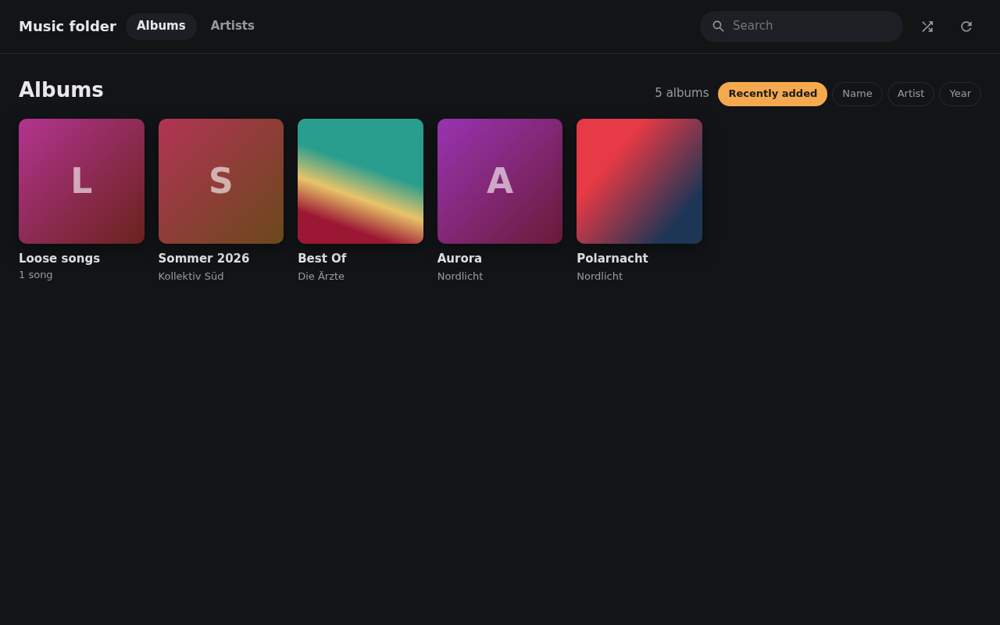
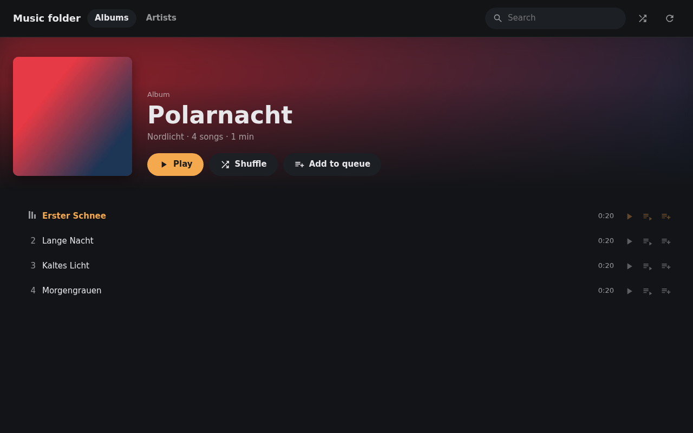

# Folder source for Beacon

One of the example apps for Beacon's external sources, and a complete one: it is meant to be
run, not only read. It plays a folder of music files in Beacon without
adding them to your media server. It shows up as its own tab in Beacon with albums,
artists and search. Every song plays like any other, on the speakers too, and Beacon's
own queue does the rest, shuffle included.

Handy for a folder that does not belong in the library: imports not sorted yet, DJ sets,
recordings, a friend's hard drive.



## What it does

- Reads every audio file below the folder, subfolders included, and groups them into
  albums: one album per folder and album tag. A compilation stays one album even when
  every song names another artist; `CD1`/`Disc 2` folders join their album.
- Takes title, artist, album, track and disc number, year and genre from the tags. A file
  without tags is named after its folders and file name (`Artist/Album/03 - Title.mp3`).
- Covers come from `cover.jpg`, `folder.jpg`, `front.jpg` (and `.png`, `.webp`) in the
  album folder, or from the cover embedded in a song.
- Looks for new music every 30 minutes, or when you press the refresh button. Only new
  and changed files are read again, so a large folder rescans in seconds. The first scan
  of a large folder takes a while; the page shows how many files are read and how many
  are still to go.
- Never writes to the music folder. Docker mounts it read-only.

Formats: MP3, AAC/M4A, FLAC, Ogg Vorbis, Opus, WAV and WebM audio.



## Running it

### Docker

There is no ready-made image: you build it yourself from this folder. It is not part of
Beacon's own image either.

#### Getting the folder

A clone of Beacon's repository has it at `docs/examples/folder-source`. To fetch only
this folder instead of all of Beacon:

```bash
git clone --depth 1 --filter=blob:none --sparse https://github.com/mihaitom/beacon.git
cd beacon
git sparse-checkout set docs/examples/folder-source
cd docs/examples/folder-source
```

#### Building and running on the same machine

Set the music folder and a token in `compose.yaml`, then:

```bash
docker compose up -d --build
```

Compose builds the image and starts it. To update later, `git pull` and run the same
command again; the index in `./data` stays.

#### Building for another machine

Build the image with a name of your choice:

```bash
docker build -t folder-source:1.0.0 .
```

Then get it to the server one of two ways:

- **Through a registry of your own**: tag and push it, and in the server's
  `compose.yaml` replace `build: .` with `image:` and that name.

  ```bash
  docker tag folder-source:1.0.0 registry.example.com/you/folder-source:latest
  docker push registry.example.com/you/folder-source:latest
  ```

- **Without a registry**: copy it straight over SSH, and use `image: folder-source:1.0.0`
  in the server's `compose.yaml`.

  ```bash
  docker save folder-source:1.0.0 | ssh server docker load
  ```

A server with another processor than the machine you build on, a Raspberry Pi built for
on a PC say, needs the image for its platform: `docker buildx build --platform
linux/arm64 -t registry.example.com/you/folder-source:latest --push .`

#### The data folder

`./data` holds the music index (`library.sqlite`) and the signing secret. Keep it: see
[Songs keep their identity](#songs-keep-their-identity). The container runs as uid 1000;
if your user has another uid, `chown 1000 data` once.

### Without Docker

Needs Python 3.13 and [uv](https://docs.astral.sh/uv/).

```bash
TOKEN=change-me uv run main.py /path/to/music
```

## Connecting Beacon

In Beacon: **Settings > Library > External sources > Add source**.

| Field       | Value                                               |
| ----------- | --------------------------------------------------- |
| Tab name    | Whatever the tab should be called, e.g. `Imports`   |
| Tab icon    | Any; a folder fits                                  |
| App address | `http://<host>:8800`, as Beacon's server reaches it |
| Token       | The `TOKEN` you set                                 |

"As Beacon's server reaches it" matters when Beacon runs in Docker: `localhost` there is
Beacon's own container. Use the host's address, or put both containers in one Docker
network and use `http://beacon-folder-source:8800`.

The speakers never talk to this app. They play from Beacon, which fetches from here.

Opening `http://<host>:8800/ui/` in a browser answers `Token required` while a token is
set. That is correct: only Beacon sends it. Without a token the page shows the library,
but can play only inside Beacon.

### Beacon behind a login (Authentik, Authelia, ...)

The page runs fenced off inside Beacon and cannot send your login cookie, so let the path
`/external-ui/` past the login, the same way as `/party/` for party mode. Beacon refuses
every request there that does not carry the random key it hands only to signed-in
listeners.

## Settings

All from the environment. The folder can also be the first argument.

| Variable         | Default        | What it does                                                 |
| ---------------- | -------------- | ------------------------------------------------------------ |
| `MUSIC_DIR`      | -              | The folder to serve (in Docker: mount it at `/music`)        |
| `TOKEN`          | none           | Beacon has to send it to see the page. Set one               |
| `SOURCE_NAME`    | `Music folder` | The name shown in the page's header                          |
| `RESCAN_MINUTES` | `30`           | How often to look for new music; `0`: at start and on demand |
| `DATA_DIR`       | `./data`       | Music index and secret (in Docker: `/data`)                  |
| `SECRET`         | made once      | Signs song addresses. Leave it unset unless you run copies   |
| `HOST`, `PORT`   | `0.0.0.0:8800` | Where to listen                                              |

## Security

- **The page and its API** (`/v1`, `/ui/...`) answer only with the token. Beacon adds it
  when it passes the page through; the page itself never sees it.
- **Songs and covers** are fetched by Beacon without any header, so their addresses carry
  a signature instead. Without it, nothing is served. A file cannot be named by its path:
  the app serves only what it indexed, and a symlink that leads out of the folder is
  skipped.
- `/health` answers anybody, with nothing but `{"ok": true}`.

A song address does not expire: Beacon keeps it to play the song again from the history.
Anyone who has one can play that one song. Keep the port internal and do not forward it
to the internet; only Beacon's server needs to reach it.

### Songs keep their identity

Beacon tells songs apart by their address, and the address comes from the file's place in
the folder and the secret. Moving or renaming a file makes it a new song to Beacon, and so
does a new secret: delete `data/secret` and every song played so far is a stranger.

## Development

```bash
uv sync
uv run pytest                     # needs ffmpeg, to make the test songs
uv run ruff format . && uv run ruff check .
```

The page is plain HTML, CSS and JavaScript in `folder_source/ui/`, no build step. Anything
the page loads itself has to live below `/ui/`, because Beacon passes only that part
through. Song and cover addresses handed to Beacon may point anywhere on this app.

How Beacon and the page talk to each other is in Beacon's help, under **External source
API** ([`docs/help/reference/external-source-api.md`](../../help/reference/external-source-api.md)).
The tests run in Beacon's CI too, whenever something in this folder changes.
